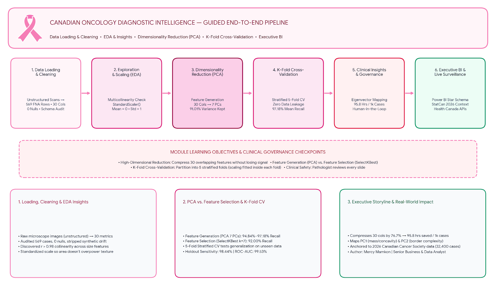

# mamkon.github.io

Personal portfolio showcasing Data Analytics, Business Intelligence, Data Science and Machine Learning projects.

## Canadian Oncology Diagnostic Intelligence

This breast biopsy case study explores whether principal component analysis (PCA) can reduce 30 nuclear morphology measurements to seven components while retaining enough information to support research on pathology worklist prioritization. The project uses 569 records from a public fine-needle aspirate dataset. Diagnostic decisions remain with the pathologist.

*Workflow overview. The 95.8 hours per 1,000 cases is a modeled capacity scenario. The holdout sensitivity and cross-validation results come from separate evaluations. The surveillance stage describes the broader design.*

- [Read the breast cancer PCA case study](https://mamkon.github.io/breast-cancer-pca/)
- [Explore the browser dashboard](https://mamkon.github.io/breast-cancer-pca/dashboard/)
- [Download the six-page Power BI Desktop project](breast-cancer-pca/powerbi/oncology-powerbi-report.zip)
- [Read the Power BI build guide](breast-cancer-pca/powerbi/POWERBI_BUILD_GUIDE.md) or [download the report theme](breast-cancer-pca/powerbi/oncology_pink_white_theme.json)
