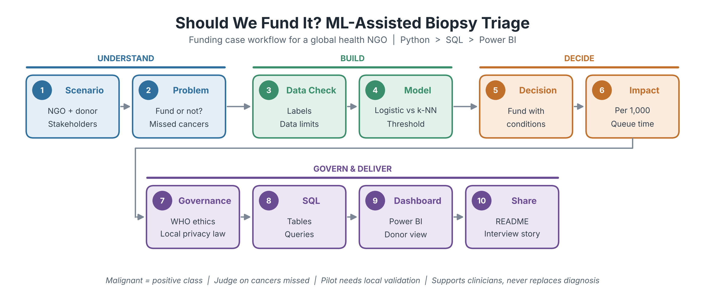

# Should We Fund It? ML-Assisted Biopsy Triage

**Mamkon Mercy Oyeleke** · Data Analytics & Business Intelligence Consultant

A funding case study: should a donor fund a global health NGO to pilot a model that reorders biopsy review queues, so likely cancers are read first in labs where pathologists are scarce?

**[Read the case study](https://mamkon.github.io/biopsy-triage/)** · **[Explore the dashboard](https://mamkon.github.io/biopsy-triage/dashboard/)** · **[Open the notebook](notebook/ml_assisted_biopsy_triage.ipynb)**

## The decision

CareBridge Health (a fictional NGO) is asking a donor to fund a 12-month pilot. The donor can fund it, fund it with conditions, or decline. Every biopsy is still read by a pathologist: the model only changes the order.

**Recommendation: fund with conditions.**

## Key results (held-out test set, 171 biopsies)

| Model and rule | Threshold | Cancers caught | Missed | False alarms | Recall | Specificity | Priority share |
|---|---|---|---|---|---|---|---|
| k-NN (k=3), default | 0.50 | 57 | 7 | 0 | 89.1% | 100.0% | 33.3% |
| k-NN (k=3), tuned | 0.07 | 62 | 2 | 5 | 96.9% | 95.3% | 39.2% |
| Logistic regression, default | 0.50 | 60 | 4 | 1 | 93.8% | 99.1% | 35.7% |
| **Logistic regression, tuned (recommended)** | **0.09** | **63** | **1** | **7** | **98.4%** | **93.5%** | **40.9%** |

- Models were judged on **malignant recall** (cancers caught), not accuracy.
- Thresholds were tuned on out-of-fold training predictions (5-fold x 10 repeats); the test set was used once.
- k-NN with k=3 can only output 0, 0.33, 0.67 or 1, so it could not reach the 98% recall target. Logistic regression could, and it explains its decisions through its coefficients.

## Impact: the queue is reordered, not reduced

Per 1,000 biopsies, using the recommended rule (illustrative: 20 reviews per day, one backlog):

| Prevalence | Cancers in priority queue | Cancers in standard queue | Days to clear priority | Days to clear all |
|---|---|---|---|---|
| 15% | 147 of 150 | 3 | 10.1 | 50.0 |
| 25% | 246 of 250 | 4 | 14.8 | 50.0 |
| 37% | 364 of 370 | 6 | 20.2 | 50.0 |

## Funding conditions

1. Re-validate on de-identified local samples before any patient-facing use (sample size set by a statistician).
2. A pathologist signs off 100% of cases. The model never diagnoses.
3. Independent review at month six. Pause if the standard-queue miss rate exceeds the locally validated rate.

## Governance

- **Data:** UCI Breast Cancer Wisconsin (Diagnostic), CC BY 4.0. Public and de-identified.
- **Main risk:** generalizability. The data comes from one US clinic in the early 1990s.
- **Privacy:** a real pilot would need to comply with host-country law (for example, Nigeria's Data Protection Act 2023) and obtain ethics approval.
- **Ethics:** draws on WHO's 2021 guidance *Ethics and governance of artificial intelligence for health* (human oversight, transparency, accountability).
- **Fairness:** no demographic fields, so subgroup performance cannot be tested.

## Repository contents

| Path | What it is |
|---|---|
| `index.html` | Written case study |
| `dashboard/` | Browser dashboard: threshold trade-off, queue simulator, model explainer |
| `notebook/ml_assisted_biopsy_triage.ipynb` | Full analysis in 16 sections, each step explained, ending with an automated numbers check |
| `sql/schema.sql`, `sql/queries.sql` | SQLite schema (4 tables) and five operational queries |
| `data/` | CSV exports: biopsies, predictions, model runs, queue scenarios |
| `powerbi/` | Power BI build guide, DAX measures and What-If parameters |

## How to run

1. Open the notebook in [Google Colab](https://colab.research.google.com/github/mamkon/mamkon.github.io/blob/main/biopsy-triage/notebook/ml_assisted_biopsy_triage.ipynb) or Jupyter.
2. Run all cells. The data loads from scikit-learn, so no download is needed.
3. The notebook builds `triage.db`, runs the SQL and exports the CSVs. The last section asserts every headline number.

Tools: Python (pandas, scikit-learn, matplotlib, seaborn), SQLite, Power BI (DAX), Google Colab.

## Limitations

Small sample (171 test cases, so one case moves recall by about 1.6 points), one 1990s US clinic, image-derived features only, no demographic fields, not clinically validated. Not for diagnosis.

## Acknowledgements

This case study applies what I learned in the **Certificate in Data Analytics, Big Data and Predictive Analytics** at **Toronto Metropolitan University, The Chang School of Continuing Education**, in particular CMTH 642 (classification vs clustering, logistic regression and k-nearest neighbours). Thank you to Dr. Ceni Babaoglu for the course labs this work builds on.

The scenario, funding framing, threshold and queue analysis, governance design, SQL layer and Power BI build are my own extension of that coursework onto a real-world question.

**Data:** Wolberg, W., Mangasarian, O., Street, N., & Street, W. (1993). Breast Cancer Wisconsin (Diagnostic) [Dataset]. UCI Machine Learning Repository. https://doi.org/10.24432/C5DW2B. Licensed CC BY 4.0. CareBridge Health is fictional.
