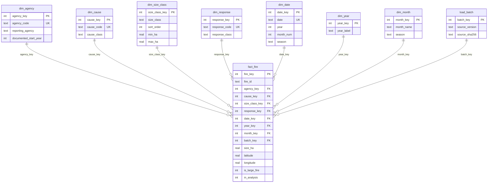

# Canada Wildfire Intelligence: technical README

A retrospective study of 168,276 Canadian wildfire records (2000–2025) that asks one decision question: **how much additional review work is worth one more large fire flagged?** Python prepares the records, a SQLite warehouse holds them, scikit-learn evaluates a ranking model on later seasons, and a three-page Power BI report presents the history and the policy trade-off.

**Status:** retrospective research on an archived snapshot. Not a live forecast.

## Evidence this README is written from

| Artifact | Identifier |
|---|---|
| Audited Power BI file | `CANADA WILDFIRE DASHBOARD - audited.pbix`, SHA-256 `33d9331a…c985ca979` |
| Research repository | `mamkon/wildfire-seasonal-risk-research` at commit `f33afbb3bf878750b3cdd55980d8d79ad3185842` |
| Portfolio repository | `mamkon/mamkon.github.io` at commit `8ab55270990c963ca5fcfcc4020cbe73ef3ef4bd` |
| Source data | CNFDB point release `20260811`, SHA-256 `85a40d9c…6bb1404b` (`data/source_versions.csv`) |
| Warehouse used for modeling | SHA-256 `fd79b03a…5b71add68` (`modeling/results/evaluation.json`) |

The DAX below was read from the audited PBIX data model. The schema, preparation rules and evaluation figures were read from the research repository at the pinned commit. Items that could not be confirmed from these files are listed under [Unverified and open items](#unverified-and-open-items).

## Populations

Four populations appear in this project. They differ on purpose.

| Population | Records | Why it differs |
|---|---:|---|
| Historical scope | 168,276 | 12 reporting agencies, 2000–2025. Prince Edward Island is excluded because its documented coverage starts later. |
| Known report month | 164,858 | 3,418 records have no valid month. |
| Mapped | 168,069 | 207 records fall outside the coordinate bounds (41°–84° N, 141°–52° W), including six large fires. |
| Modeling | 167,147 | 1,129 records with a repeated source identifier or an exact duplicate row are excluded. |

A **large fire** is a record whose final recorded area is at least 200 hectares: 9,594 records, 5.70% of the historical scope. The largest 3% of records hold 96.2% of pooled recorded area.

## ETL workflow

ETL means extract, transform, and load. The pipeline keeps one warehouse row per source record so exclusions can be traced back to their flags.

### Extract

`src/download_data.py` retrieves the Canadian National Fire Database (CNFDB) point release. Preparation verifies the source file against the SHA-256 checksum in `data/source_versions.csv` before processing it.

### Transform

`src/prepare_cnfdb.py` flags records and never deletes or corrects them. Each rule is a column, so every exclusion can be audited.

1. **Standardize fields.** Year, month, day, size and coordinates are parsed as numbers. Agency codes are upper-cased.
2. **Flag quality problems.** Flags cover exact duplicate rows, repeated fire identifiers, invalid year or month, missing or negative size, coordinates outside bounds, invalid calendar dates, report dates that conflict with the calendar fields, and out-dates before report dates.
3. **Classify.** Cause codes map to cause classes through `data/seeds/cause_mapping.csv`. Response codes map to full, modified or monitored. Prescribed fires are flagged from the prescribed indicator and four other source fields.
4. **Derive.** Size band, the ≥200 ha outcome, and a whole-degree grid cell from rounded coordinates.
5. **Set eligibility.** A record is eligible unless it has an invalid year, invalid size, unknown agency, a year before the agency's documented start, an exact duplicate row, or a prescribed-fire flag.

Size bands: under 1 ha, 1 to under 10, 10 to under 200, 200 to under 1,000, 1,000 to under 10,000, and 10,000+ ha.

### Load and validate

`src/load_warehouse.py` loads the prepared records, dimensions, and batch metadata into SQLite. It applies the 2000–2025 reporting scope through `in_analysis` and keeps flagged records available for review. Before replacing the database, the loader checks foreign keys and database integrity. It also exports tables and reference views. `src/reconcile.py` independently checks those views against pandas calculations.

The Power BI report contains validated historical and model-evaluation aggregates. Its historical snapshot is embedded. The API-enabled report copy adds a separate WildFire Update page sourced from the Natural Resources Canada feed for its stated reporting window.

## SQLite warehouse

Defined in `sql/01_schema.sql`. Foreign keys are enforced per connection.

| Table | Grain | Notes |
|---|---|---|
| `fact_fire` | One source row | Includes flagged and excluded records. `in_analysis` marks the eligible cohort. |
| `dim_agency` | One reporting agency | Reporting agency, not geographic jurisdiction. |
| `dim_cause` | One normalized cause code | |
| `dim_size_class` | One size interval | Upper bound exclusive. |
| `dim_response` | One response code | Includes unmapped local codes. |
| `dim_date` | One valid calendar date | Key `-1` is Unknown. Dates are never imputed. |
| `dim_year`, `dim_month` | One year, one month | Separate so partial dates stay in period totals. |
| `load_batch` | One ingestion of a pinned snapshot | Source version, hash and analysis window. |
| `fact_nfd_annual` | Jurisdiction, year, category, release | **Empty.** Reserved for official National Forestry Database tables. |

`fact_fire` carries the keys to every dimension, the measures (`size_ha`, `latitude`, `longitude`, `is_large_fire`), and the quality flags as columns. Check constraints hold latitude to 41–84, longitude to −141 to −52, and size to zero or above. One index, `fire_scope`, covers `(in_analysis, year_key, agency_key)`.

### Entity relationship diagram

Each fire record points to exactly one row in every dimension. Each dimension row can describe many fire records. Quality-flag columns on `fact_fire` are omitted here for readability.



`fact_nfd_annual` stands alone with no foreign keys and is not shown.

The other SQL files: `02_analysis_queries.sql`, `03_reference_views.sql`, `04_quality_checks.sql`, `05_reconciliation.sql`.

The warehouse and the Power BI model are different things. The warehouse holds row-level research data. The report holds aggregate tables exported from it.

## Model evaluation

### Design

- **Outcome:** final recorded area ≥200 ha.
- **Inputs:** report month, reporting agency, latitude, longitude.
- **Left out:** final area, response classification, cause, containment dates, fire identifiers, year.
- **Preprocessing, fitted inside each fold:** median fill with a missing indicator and standard scaling for coordinates; an explicit `Unknown` category and one-hot encoding for month and agency.
- **Candidates:** logistic regression (`C=1.0`) and histogram-based gradient boosting (120 iterations, 15 leaf nodes, learning rate 0.08). Random state 42 for both.

### Chronological split

| Stage | Years | Records | Large fires | Share |
|---|---|---:|---:|---:|
| Training and model selection | 2000–2019 | 132,037 | 6,446 | 4.88% |
| Threshold setting | 2020–2022 | 16,296 | 1,089 | 6.68% |
| Held-out test | 2023–2025 | 18,814 | 2,027 | 10.77% |

"Calibration" in the repository means threshold setting. The scores are ranking outputs and their probability calibration was not studied.

### Model selection

Five expanding-window folds. The first trains through 2009 and validates on 2010–2011; each later fold adds two years.

| Candidate | Forward average precision | Stratified average precision |
|---|---:|---:|
| Logistic regression | 0.285 ± 0.058 | 0.264 ± 0.007 |
| Gradient boosting | 0.369 ± 0.071 | 0.374 ± 0.016 |

Only the forward folds decide selection. Gradient boosting was selected.

### Threshold rule

For a miss-cost multiplier *m*:

> cost = false positives + *m* × false negatives

Every distinct score in the 2020–2022 records was evaluated, plus the option to alert nobody. The cost-minimizing threshold was frozen before the test years were scored.

### Held-out results, 2023–2025

| Policy | Threshold | TP | FP | FN | TN | Recall | Precision | Review rate | Cost at 10× |
|---|---:|---:|---:|---:|---:|---:|---:|---:|---:|
| Default 0.50 | 0.5000 | 81 | 45 | 1,946 | 16,742 | 4.00% | 64.29% | 0.67% | 19,505 |
| Miss cost 2× | 0.3015 | 595 | 454 | 1,432 | 16,333 | 29.35% | 56.72% | 5.58% | 14,774 |
| Miss cost 5× | 0.0733 | 1,278 | 2,203 | 749 | 14,584 | 63.05% | 36.71% | 18.50% | 9,693 |
| **Miss cost 10×** | 0.0425 | 1,498 | 3,793 | 529 | 12,994 | 73.90% | 28.31% | 28.12% | 9,083 |
| Miss cost 20× | 0.0314 | 1,634 | 4,932 | 393 | 11,855 | 80.61% | 24.89% | 34.90% | 8,862 |

Ranking quality on the test years: ROC AUC 0.838 and average precision 0.427, against 0.108 for a constant score. Accuracy for the 10× policy is 77.03%. Clearing every record scores 89.23% and misses all 2,027 large fires.

TP means true positives, FP false positives, FN false negatives, and TN true negatives.

The 10× policy by year:

| Year | Records | Large fires | Share | Recall | Precision | Review rate |
|---|---:|---:|---:|---:|---:|---:|
| 2023 | 6,820 | 965 | 14.15% | 72.75% | 33.49% | 30.73% |
| 2024 | 5,814 | 533 | 9.17% | 75.05% | 24.07% | 28.59% |
| 2025 | 6,180 | 529 | 8.56% | 74.86% | 25.83% | 24.81% |

### Agency-by-month baseline

I estimated historical large-fire rates by reporting agency and month using only 2000–2019 records. Missing months had their own group. Unseen combinations fell back to the agency rate, then the overall training rate. The threshold was chosen on 2020–2022 under the same 10× miss-cost assumption. The comparison uses the same 18,814 held-out records from 2023–2025.

| Held-out measure | Agency-by-month lookup | Gradient boosting |
| --- | ---: | ---: |
| Average precision | 0.293 | 0.427 |
| Large fires flagged | 1,202 | 1,498 |
| Total reviews | 4,153 | 5,291 |
| Cost at 10× | 11,201 | 9,083 |

Gradient boosting ranked large fires better in this test. At their separately selected thresholds, it flagged 296 more large fires and required 1,138 more reviews. Those operating points use different workloads. [Baseline results](agency-month-baseline.json)

### The 10× to 20× trade-off

Moving from 10× to 20× on the held-out records adds 1,275 reviews (5,291 to 6,566) and flags 136 more large fires. That is about 9.4 additional reviews per additional large fire flagged. Of the 1,275, 136 are the large fires themselves and 1,139 are additional false alerts, or about 8.4 false alerts per additional large fire. Both ratios are correct; state which one is meant.

### Two observations, reported without a causal claim

1. **The large-fire share rose across the splits:** 4.88%, then 6.68%, then 10.77%.
2. **Under the 10× cost formula, the 20× threshold cost less on the test years.** On the threshold-setting years the 10× threshold cost 5,254 against 5,533 for 20×. On the test years it cost 9,083 against 8,862.

This study does not establish that the first observation explains the second. A threshold chosen after seeing the test years needs a new untouched test window.

## Power BI model

Fourteen embedded tables contain historical aggregates, evaluation results, or slicer and display labels.

| Table | Grain |
|---|---|
| `National` | Year: records, hectares, large fires |
| `Monthly` | Year and month: records |
| `Geographic` | Year and jurisdiction: records, area |
| `Trend` | Year: area in million ha, trailing five-year mean |
| `Size` | Size band: records |
| `Concentration` | Largest 1%, 3%, 5%, 10% of records: area share |
| `Agency` | Reporting agency: large-fire share |
| `Cells` | Whole-degree cell: latitude, longitude, large fires |
| `Policy Results` | Policy: threshold, records, TP, FP, FN, TN |
| `Yearly Test` | Test year: records, TP, FP, FN, TN (10× policy) |
| `Study Year`, `Jurisdiction` | Slicer dimensions |
| `Policy Selection` | Disconnected policy selector |
| `Observed Size` | Row labels for the confusion matrix |

**Relationships verified in Power BI Desktop** · Five active one-to-many, single-direction relationships. `Study Year` filters `National`, `Monthly`, `Geographic` and `Yearly Test`. `Jurisdiction` filters `Geographic`. `Policy Selection` is intentionally disconnected.

### DAX measures

These are the expressions stored in the audited PBIX. Only line breaks and indentation were added.

**National history**

```dax
Fire records = SUM('National'[Records])

Recorded hectares = SUM('National'[Hectares])

Large-fire records = SUM('National'[Large])

Large-fire share = DIVIDE([Large-fire records], [Fire records])

Report period =
VAR Years = VALUES('Study Year'[Year])
VAR N = COUNTROWS(Years)
VAR FirstYear = MIN('Study Year'[Year])
VAR LastYear = MAX('Study Year'[Year])
RETURN
    SWITCH(
        TRUE(),
        N = 0, "No years",
        N = 1, FirstYear,
        VALUE(LastYear) - VALUE(FirstYear) + 1 = N, FirstYear & "–" & LastYear,
        FORMAT(N, "0") & " selected years"
    )

Known-month records = SUM('Monthly'[Records])

Unknown-month records = [Fire records] - [Known-month records]

Area (million ha) = SUM('Trend'[Area])

Five-year mean = IF(HASONEVALUE('Trend'[Year]), MAX('Trend'[Rolling mean]))
```

**Geography and fire size**

```dax
Mapped records = SUM('Geographic'[Records])

Mapped area (ha) = SUM('Geographic'[Area])

Size-band records = SUM('Size'[Records])

Area share =
IF(HASONEVALUE('Concentration'[Largest records]), MAX('Concentration'[Share]))

Agency large-fire share =
IF(HASONEVALUE('Agency'[Reporting agency]), MAX('Agency'[Share]))

Cell latitude = AVERAGE('Cells'[Latitude])

Cell longitude = AVERAGE('Cells'[Longitude])

Cell large fires = SUM('Cells'[Large])
```

`Area share`, `Agency large-fire share` and `Five-year mean` return blank for combined rows. The percentile bands overlap and agency shares have different denominators, so a total would have no meaning.

**Policy selection.** The slicer reads the disconnected `Policy Selection` table. With nothing selected, the cards fall back to 10×.

```dax
Effective alert policy =
SELECTEDVALUE('Policy Selection'[Policy], "Miss cost 10×")

Selected true positives =
VAR Choice = SELECTEDVALUE('Policy Selection'[Policy], "Miss cost 10×")
RETURN
    CALCULATE(
        SUM('Policy Results'[True positives]),
        'Policy Results'[Policy] = Choice
    )

Selected false positives =
VAR Choice = SELECTEDVALUE('Policy Selection'[Policy], "Miss cost 10×")
RETURN
    CALCULATE(
        SUM('Policy Results'[False positives]),
        'Policy Results'[Policy] = Choice
    )

Selected false negatives =
VAR Choice = SELECTEDVALUE('Policy Selection'[Policy], "Miss cost 10×")
RETURN
    CALCULATE(
        SUM('Policy Results'[False negatives]),
        'Policy Results'[Policy] = Choice
    )

Selected true negatives =
VAR Choice = SELECTEDVALUE('Policy Selection'[Policy], "Miss cost 10×")
RETURN
    CALCULATE(
        SUM('Policy Results'[True negatives]),
        'Policy Results'[Policy] = Choice
    )

Selected reviews = [Selected true positives] + [Selected false positives]

Selected recall =
DIVIDE(
    [Selected true positives],
    [Selected true positives] + [Selected false negatives]
)

Selected precision =
DIVIDE(
    [Selected true positives],
    [Selected true positives] + [Selected false positives]
)

Selected review rate =
DIVIDE(
    [Selected true positives] + [Selected false positives],
    [Selected true positives] + [Selected false positives]
        + [Selected true negatives] + [Selected false negatives]
)
```

**Confusion matrix.** Rows come from `Observed Size`.

```dax
Alert =
SWITCH(
    SELECTEDVALUE('Observed Size'[Final size]),
    "≥200 ha", [Selected true positives],
    "<200 ha", [Selected false positives]
)

No alert =
SWITCH(
    SELECTEDVALUE('Observed Size'[Final size]),
    "≥200 ha", [Selected false negatives],
    "<200 ha", [Selected true negatives]
)
```

**Five-policy comparison.** Each policy scores the same 18,814 records, so these return blank when more than one policy is in context.

```dax
Recall =
IF(
    HASONEVALUE('Policy Results'[Policy]),
    DIVIDE(
        SUM('Policy Results'[True positives]),
        SUM('Policy Results'[True positives]) + SUM('Policy Results'[False negatives])
    )
)

Precision =
IF(
    HASONEVALUE('Policy Results'[Policy]),
    DIVIDE(
        SUM('Policy Results'[True positives]),
        SUM('Policy Results'[True positives]) + SUM('Policy Results'[False positives])
    )
)

Review rate =
IF(
    HASONEVALUE('Policy Results'[Policy]),
    DIVIDE(
        SUM('Policy Results'[True positives]) + SUM('Policy Results'[False positives]),
        SUM('Policy Results'[Records])
    )
)
```

**Annual results for the 10× policy**

```dax
Yearly records = SUM('Yearly Test'[Records])
Yearly true positives = SUM('Yearly Test'[True positives])
Yearly false positives = SUM('Yearly Test'[False positives])
Yearly false negatives = SUM('Yearly Test'[False negatives])
Yearly true negatives = SUM('Yearly Test'[True negatives])

Yearly recall =
DIVIDE([Yearly true positives], [Yearly true positives] + [Yearly false negatives])

Yearly precision =
DIVIDE([Yearly true positives], [Yearly true positives] + [Yearly false positives])

Yearly review rate =
DIVIDE([Yearly true positives] + [Yearly false positives], [Yearly records])
```

Selecting a policy changes which stored row is displayed. It does not retrain or rescore anything.

## Validation

### Report against source

| Check | Report | Source | Result |
|---|---:|---:|---|
| National records | 168,276 | 168,276 | Match |
| National area (ha) | 83,988,359.26 | 83,988,359.254 | Match within rounding of year-level values |
| Large fires | 9,594 | 9,594 | Match |
| Known / unknown month | 164,858 / 3,418 | 164,858 / 3,418 | Match |
| Mapped records | 168,069 | 168,069 | Match; 207 outside bounds |
| Mapped area (ha) | 83,984,990.73 | 83,984,990.767 | 0.04 ha difference from row rounding |
| Large-fire cells | 9,588 in 920 cells | 9,588 in 920 cells | Match |
| Top 10% area share | 99.80244% | 99.80244% | Match |
| Top 3% area share | 96.2133% | 96.2133% (`vw_concentration.csv`) | Match |
| Policy rows | 5 rows | `test_policies.csv` | All counts and thresholds match |
| Annual rows | 3 rows | `test_by_year.csv` | All counts match |

### Checks recorded in the audit

- 35 DAX checks run in Power BI Desktop, including the default period, a single year, a non-contiguous selection, blank totals for the four guarded measures, and the 20× selection.
- All seven delivered files match the SHA-256 manifest.
- `tests/test_preparation.py`, `tests/test_sql_layer.py` and `tests/test_modeling.py` cover the preparation, SQL and modeling layers on fixtures.
- SQL reference views are compared with separate pandas calculations in `src/reconcile.py`.

### The 2023 caveat

The project's 2023 scope is 6,825 records and 17,606,408 ha. The full 2023 source-year total, before project exclusions, matches the count and rounded area in the 2025 national annual report (6,837 fires, 17,606,547 ha). An earlier published indicator lists 6,811 fires and 17,197,201 ha. Jurisdiction-by-year reconciliation against the National Forestry Database has not been done and `fact_nfd_annual` is empty, so 2023 area stays labelled as pending reconciliation.

## Reproduce

Python 3.12, with scikit-learn 1.9.1, pandas 3.0.1 and NumPy 2.5.4.

```sh
git clone https://github.com/mamkon/wildfire-seasonal-risk-research.git
cd wildfire-seasonal-risk-research
git checkout f33afbb3bf878750b3cdd55980d8d79ad3185842
python -m pip install -r requirements.txt -r modeling/requirements.txt

# Prepare the data and build the warehouse
python -m src.download_data
python -m src.prepare_cnfdb
python -m src.load_warehouse

# Train, set thresholds, and score the held-out years
python -m modeling.run --miss-cost 10

# Tests
python -m pytest tests -q
```

The pinned revision can fail warehouse fixture tests when pandas rejects filling a categorical size-class key with the Unknown key. The later local ETL fix converts the mapped key to a nullable integer before filling.

`download_data` verifies the pinned SHA-256. If the provider has replaced the release, place the matching `NFDB_point_20260811.txt` in `data/raw/` first. With an existing reviewed warehouse, skip the three preparation commands and pass `--warehouse PATH`.

To rebuild the dashboard's geographic evidence, run this from the portfolio repository at commit `8ab55270990c963ca5fcfcc4020cbe73ef3ef4bd`:

```powershell
python wildfire-triage/dashboard/data/build_geography.py "C:/data/NFDB_point_20260811.txt" "C:/repos/wildfire-seasonal-risk-research"
```

The Power BI file is a static snapshot. Refresh in Desktop does not fetch a new source release. Replace the embedded tables only after the reconciliation table above passes again.

## Unverified and open items

**Not yet run**

- The model without reporting agency. Large-fire share ranges from 0.1% (NB) to 31.0% (NT) across agencies, so agency may carry reporting practice as well as fire behaviour.
- A fresh test window for any threshold chosen after seeing 2023–2025.

**Not confirmed from the files**

- The audited PBIX is not in either repository at the pinned commits. The research repository's `dashboard/` folder holds a different, 13-page Power BI project with Azure Maps. The three-page audited PBIX is the report described here.
- The DAX validation file lists observed values only. It has no expected value or pass flag per check.

**Open in the audit**

- Tooltips on the coordinate and policy scatterplots.
- Full keyboard traversal and screen-reader output. Alternative text and tab order are authored but untested.
- A completed data export.
- Phone layout on a physical device. The Predictive Triage header needs internal scrolling.

**Limits of the study**

- The archive holds fires already recorded. The model does not estimate ignition probability.
- The archive cannot show that coordinates and report month were available and unchanged at alert time.
- Recorded area is not a measure of ecological severity, community exposure or financial loss.
- Miss-cost multipliers are planning assumptions. Staffing needs and prevented losses were not measured.

## Sources

- Canadian Forest Service. *Canadian National Fire Database: Agency Fire Data.* Natural Resources Canada. [Source directory](https://cwfis.cfs.nrcan.gc.ca/downloads/nfdb/fire_pnt/current_version/). Contains information licensed under the Open Government Licence – Canada.
- [Research repository at the pinned commit](https://github.com/mamkon/wildfire-seasonal-risk-research/tree/f33afbb3bf878750b3cdd55980d8d79ad3185842)
- [Portfolio dashboard data at the pinned commit](https://github.com/mamkon/mamkon.github.io/tree/8ab55270990c963ca5fcfcc4020cbe73ef3ef4bd/wildfire-triage/dashboard/data)
